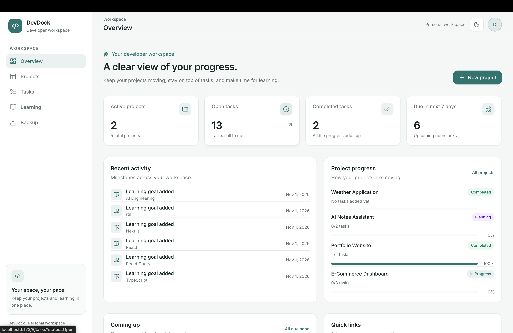
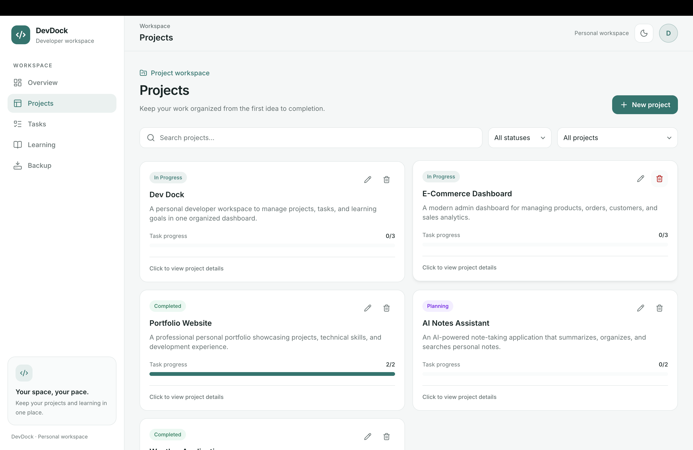
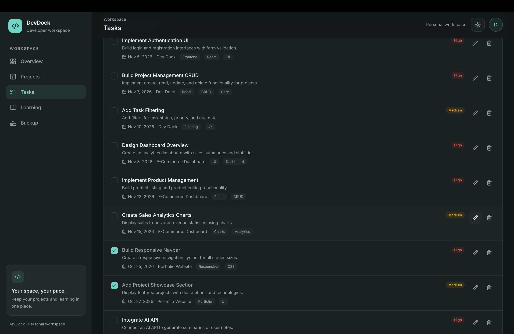
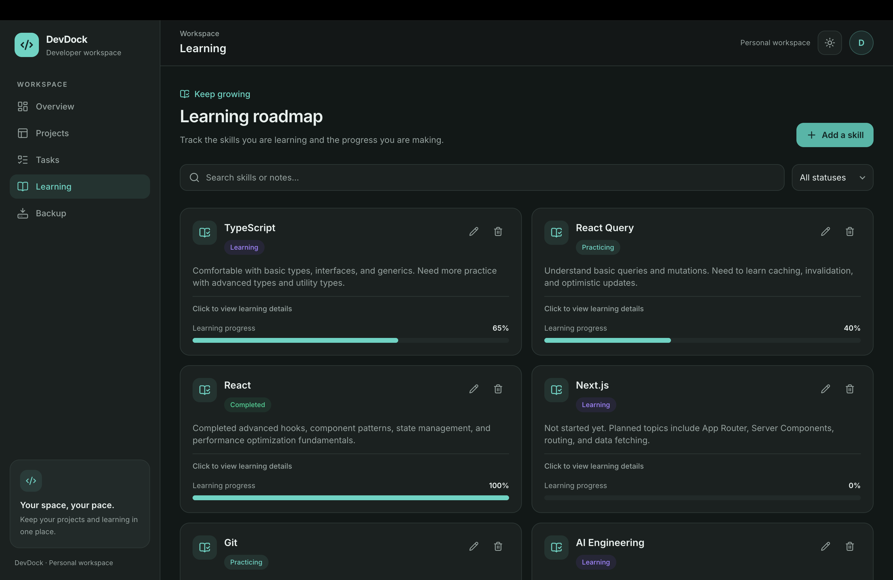

# DevDock

A personal developer dashboard for organizing projects, tasks, and learning goals in one place. DevDock runs entirely in the browser with no backend: your data stays in `localStorage` on your device.

**Live demo:** [devdock.ahmadireza-1791.workers.dev](https://devdock.ahmadireza-1791.workers.dev/)

## Screenshots

### Light Mode

| Overview                                            | Projects                                            |
| --------------------------------------------------- | --------------------------------------------------- |
|  |  |

### Dark Mode

| Tasks                                       | Learning                                          |
| ------------------------------------------- | ------------------------------------------------- |
|  |  |

## Features

### Workspace

- **Overview** with metric cards, a recent activity feed, project progress, upcoming tasks (due in the next 7 days), and quick links.
- **Projects** with Planning / In Progress / Completed status, search, status filter, and progress based on linked tasks.
- **Tasks** with completion toggle, priority, due date, comma-separated tags, project association, and search, status, priority, and project filters. Overdue open tasks are highlighted.
- **Learning goals** with skill name, Learning / Practicing / Completed status, progress, notes, search, and status filter.
- **Backup** page to export the workspace as a versioned JSON file and restore it later. Restore validates the file and asks for confirmation; invalid files never change your data.

### Data and reliability

- Persistent `localStorage` storage with a versioned schema and validation on load.
- Malformed saved data is copied to a `devdock-workspace-v1.corrupt-*` recovery key before any write. If that copy fails, writes stay blocked to protect the original data.
- Changes made in another browser tab are validated and synced.
- An error boundary catches rendering failures.

### Interface

- Light and dark themes, saved in `localStorage` under `devdock-theme`.
- Responsive layout with a mobile navigation drawer.
- Read-only detail dialogs, a shared confirmation dialog for destructive actions, and auto-expiring toast notifications.
- Forms validated with React Hook Form and Zod.
- Short Motion transitions that respect the user's reduced-motion preference.
- Accessibility work: focus-managed dialogs, keyboard-accessible cards, and contrast-checked colors.
- Locally hosted Inter and Vazirmatn fonts (SIL Open Font License; licenses are in `src/assets/fonts/`).

## Tech Stack

| Area                 | Technology                                                         |
| -------------------- | ------------------------------------------------------------------ |
| UI                   | React 19, TypeScript                                               |
| Build tool           | Vite, `@vitejs/plugin-react`                                       |
| Styling              | Tailwind CSS v4 (`@tailwindcss/vite`)                              |
| Routing              | React Router (`HashRouter`)                                        |
| State                | Zustand (store composed from slices)                               |
| Forms and validation | React Hook Form, Zod, `@hookform/resolvers`                        |
| Animation            | Motion                                                             |
| Icons                | Lucide React                                                       |
| Linting              | ESLint, `typescript-eslint`, React Hooks and React Refresh plugins |

## Getting Started

### Prerequisites

- Node.js **22.22 or later** (required by the installed `react-router` version)
- npm (a `package-lock.json` is included)

No environment variables are required.

### Installation

```bash
git clone https://github.com/reza-ahmadi-git/devdock.git
cd devdock
npm install
```

### Run in development

```bash
npm run dev
```

Vite prints the local address, `http://localhost:5173` by default.

### Build for production

```bash
npm run build
npm run preview
```

The production files are generated in `dist/`. Because the app uses `HashRouter`, it works on any static host without server rewrite rules.

## Scripts

| Command           | Description                                    |
| ----------------- | ---------------------------------------------- |
| `npm run dev`     | Start the Vite development server              |
| `npm run build`   | Type-check (`tsc -b`) and build for production |
| `npm run lint`    | Run ESLint                                     |
| `npm run preview` | Preview the production build locally           |

## Project Structure

```text
.
├── public/
│   └── favicon.svg
├── src/
│   ├── app/
│   │   ├── layouts/        # App shell, sidebar, top bar, navigation
│   │   └── routes/         # Route definitions
│   ├── features/
│   │   ├── backup/         # JSON export and validated restore
│   │   ├── dashboard/      # Overview page, stat cards, and sections
│   │   ├── learning/       # Learning goals and their schemas
│   │   ├── projects/       # Projects and their schemas
│   │   └── tasks/          # Tasks and their schemas
│   ├── shared/
│   │   ├── components/     # Modal, dialogs, toasts, empty state, error boundary
│   │   ├── hooks/          # Theme and list-motion hooks
│   │   ├── lib/            # Dates, ids, badge classes, storage and validation
│   │   ├── store/          # Zustand slices and selectors
│   │   └── types/          # Workspace data model
│   ├── assets/fonts/       # Bundled fonts and their licenses
│   ├── App.tsx
│   ├── index.css           # Tailwind import, theme tokens, shared utilities
│   └── main.tsx            # Entry point, HashRouter, error boundary
├── index.html
├── vite.config.ts
├── eslint.config.js
└── tsconfig*.json
```

Feature code (components, schemas) lives inside its feature folder. `shared/` holds only code reused across features.

## Data and Privacy

- All data is stored in your browser: workspace data under `devdock-workspace-v1` (data schema version 2) and the theme under `devdock-theme`. Nothing is sent to a server.
- Data is **per browser and per domain**. A different browser, device, or hosting address starts with an empty workspace. Use **Backup** to move data between them.
- Browser storage can be cleared by the browser or the user. Export backups regularly, and avoid storing sensitive information in the app.
